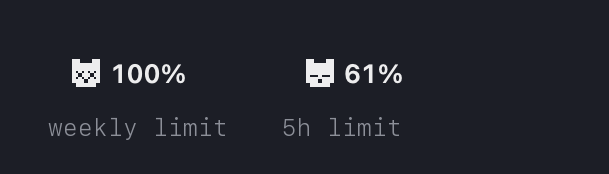
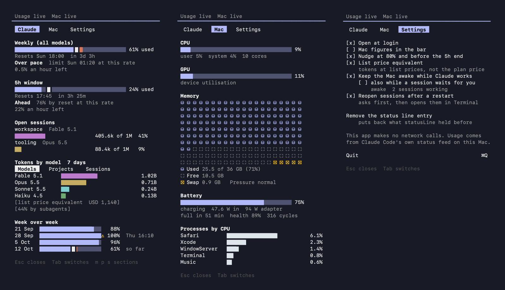

# tokenpanda

A macOS menu bar app that tells me if I am ahead of the clock on my Claude plan, or behind it.

[](https://github.com/tokenpandadev/tokenpanda-app/releases/latest) [](LICENSE) [](https://github.com/tokenpandadev/tokenpanda-app/actions/workflows/build.yml) [](https://www.bestpractices.dev/projects/15513) [](https://api.reuse.software/info/github.com/tokenpandadev/tokenpanda-app) [](#install)


Every time I looked at a usage percentage I did the same sum in my head. It is Thursday afternoon, 61 percent is gone, the week resets Sunday evening. Am I ahead of the clock or behind it? When does it run out if I keep going like this? So the popover says it in words and in clock time, not as a gauge.

## What it shows

- The pace in words: Ahead, On pace or Over pace, the clock time the limit lands if nothing changes, and what is left per hour.
- The 5h window and the week, each as a bar with a tick where the clock stands and the reset as a clock time.
- Open Claude Code sessions, each with its context window as a bar.
- Tokens by model, project and session, counted from the transcripts already on the Mac, with the list price equivalent and week over week.
- The Mac on a second tab: CPU, GPU, memory with pressure and swap, battery, the busiest processes.
- A switch in Settings, off by default, keeps the Mac from idle sleep while a Claude Code session is working, and says so while it does. A second switch under it keeps it awake while any session is open, idle ones too, so a session stays reachable through Remote Control from the phone. It prevents idle sleep only: a closed lid on battery still sleeps the Mac.


The menu bar item: the panda and the weekly percentage, dimmed when the figures are older than an hour.



When a window is used up, the panda's eyes say so until it resets: x x for the weekly limit, - - for the 5h window.



The three tabs: Claude, Mac and Settings.

## Install

Download `tokenpanda-<version>.zip` and `tokenpanda-<version>.zip.sha256` from the [releases page](https://github.com/tokenpandadev/tokenpanda-app/releases), then check the zip in the folder you saved both to:

```sh
shasum -a 256 -c tokenpanda-<version>.zip.sha256
```

It should print `OK`. Unzip it and move `tokenpanda.app` to Applications.

The first launch, said plainly: the app is signed ad hoc, not notarised, so macOS blocks it the first time. Try to open it, then open System Settings, click Privacy & Security, scroll down and click Open Anyway. The warning comes back once more; click Open. From then on it opens normally. On macOS 26 and later, if the item does not show in the menu bar, allow it in System Settings under Menu Bar.

With Homebrew:

```sh
brew install tokenpandadev/tap/tokenpanda
```

The Open Anyway step applies after a Homebrew install too.

On first launch the Claude tab offers one button, Install the status line hook. Click it, start a Claude Code session, and the figures arrive after the first reply. If you already have a status line, it keeps working.

## By the rules

- It reads the status line, the one feed Claude Code documents for exactly this, and nothing else. The plan figures are four fields in it: `rate_limits.five_hour` and `rate_limits.seven_day`, each with `used_percentage` and `resets_at`.
- The token figures come from the transcripts Claude Code keeps on the Mac in `~/.claude/projects`. Counts, model and time. Never what was written.
- No login. No token. No endpoint. No network at all.

The honest consequence: the plan figures are as fresh as the last running session. Between sessions the popover shows the last figures with the time they were read.

## Privacy

Nothing leaves your Mac. In five rules:

1. The app makes no network calls and works offline: no analytics, no telemetry, no update check, no price fetch.
2. From a transcript line it keeps the time, the ids, the model, the working directory name and the token counts. Not what you wrote, not what Claude answered.
3. It never opens `memory/` or `tool-results/`, never reads the Keychain, a token or a cookie, and never asks you to sign in.
4. It touches `~/.claude/settings.json` only when you click, and only its `statusLine` key. "Remove the status line entry" in Settings puts your previous entry back exactly.
5. Check it. The source is public; search it for URLSession. Run nettop on the app for an hour: zero connections.

With keep awake on, the app holds a power assertion only while a session is working, or with the second switch while a session is open, and `pmset -g assertions` shows it.

The [privacy page](docs/privacy.html) names every file it reads and writes. Anthropic documents the status line feed as input for any script you configure. It has written nothing either way about a local tool reading the transcripts on your own Mac. That is silence, not permission, and I would rather say so than claim more.

## Build from source

You need a Mac on macOS 14 or later with the Command Line Tools or Xcode. Swift 6 is required; nothing else is downloaded.

```sh
swift build
swift test -Xswiftc -plugin-path -Xswiftc /Library/Developer/CommandLineTools/usr/lib/swift/host/plugins/testing
scripts/build-app.sh 0.1.5
open build/tokenpanda.app
```

The plugin flag is for the Command Line Tools, which ship swift-testing without telling the compiler where its macro plugin lives. With Xcode selected, plain `swift test` works. `scripts/build-app.sh` builds the release binary, assembles `build/tokenpanda.app`, signs it ad hoc, and writes `build/tokenpanda-<version>.zip` with its SHA-256. A debug build also takes `--snapshot <folder>`, which renders every tab and state of the sample data to PNG.

The documentation is plain HTML in `docs/`: an overview, the style guide, the spec and the privacy page. Changes per version are in [CHANGELOG.md](CHANGELOG.md).

## Good tools that came first

Plenty of good tools came before this one, and I learned from all of them.

- [Headroom](https://github.com/sandrich/headroom): Mac stats and the Claude Code limits in one small menu bar item, in Swift, MIT. It is the reason I started.
- [Pacer](https://github.com/EricAndrechek/Pacer): pace gauges for the 5h window, the week and each model, in a native Mac app. MIT.
- [TokenPace](https://github.com/artem-from-ua/tokenpace): coloured pacing bars for the Claude Code limits in the menu bar, so the pace is a glance.
- [Usage Pacer](https://github.com/liammday/usage-pacer-releases): a notarised menu bar app that draws a pace line for Claude subscription usage. MIT.
- [ccusage](https://github.com/ccusage/ccusage): the command line tool that started the token counting; one npx and the figures are there.
- [CodexBar](https://github.com/steipete/CodexBar): usage for Codex, Claude Code and many other providers in one menu bar item. Swift, MIT.
- [CCSeva](https://github.com/Iamshankhadeep/ccseva): a native Swift popover with a live view, burn rate, projection and weekly history.
- [claude-hud](https://github.com/jarrodwatts/claude-hud): a status line inside Claude Code itself: context use, the active tool, running agents, todo progress.

## Licence and coffee

MIT, see [LICENSE](LICENSE). Issues and ideas welcome.

If it saved you a limit once, a coffee on [Ko-fi](https://ko-fi.com/tokenpanda) is welcome, never required. GitHub Sponsors follows once GitHub approves it.
